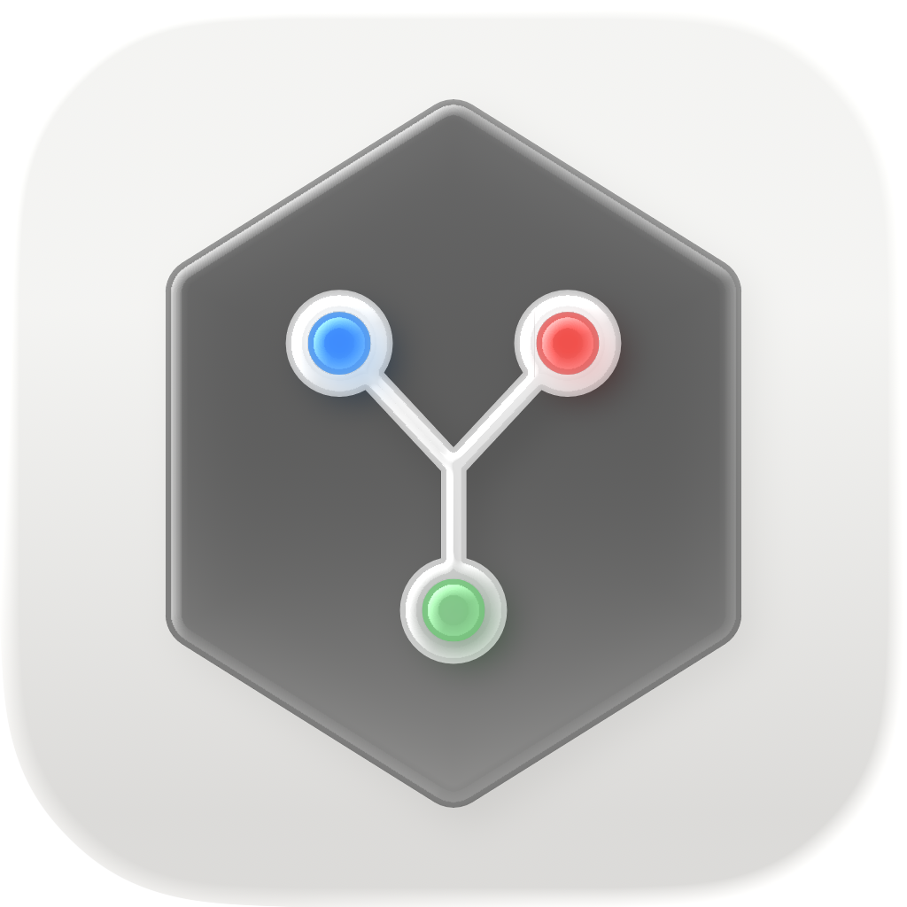

# RunHub

<p align="center">
  
</p>

RunHub is a macOS menu bar app for managing self-hosted GitHub Actions runners.
It adopts runners you have already configured and launches them inside your logged-in
GUI session, keeping signing certificates, provisioning profiles, and notarization
credentials in the unlocked login Keychain available to jobs.

## Install

1. Download `RunHub.zip` from the
   [latest GitHub Release](https://github.com/yumaitau/RunHub/releases/latest).
2. Extract the archive and move `RunHub.app` to your Applications folder.
3. Open RunHub. Its icon appears in the menu bar rather than the Dock.

Published builds are signed with a Developer ID certificate and notarized by Apple.

## Features

- Add an existing runner by selecting its configured folder.
- See Stopped, Starting, Idle, Busy, and Failed states at a glance.
- Show the current workflow job name while a runner is busy.
- Start or stop individual runners, or control all runners together.
- Restore runners that you intended to leave running when RunHub launches again.
- Stop the complete runner process tree on Stop or Quit, avoiding orphaned jobs.
- Warn before quitting while a job is running.
- Optionally enrich local status with GitHub's authoritative status through `gh`.
- Launch RunHub automatically when you log in.

RunHub is a menu bar utility: it does not display a Dock icon or a conventional app
window. Its menu bar icon becomes active while any runner is processing a job.

## Why run runners in-session?

Installing a runner as a service with `svc.sh` moves it out of the logged-in GUI
session. That can prevent macOS and Xcode jobs from accessing credentials in the
unlocked login Keychain.

RunHub instead starts each runner's `run.sh` as a child process of the app. The runner
and its jobs remain in the user's session, while RunHub owns their lifecycle and status.

## Requirements

To use RunHub:

- macOS 14.6 or later.
- One or more self-hosted GitHub Actions runners that have already been configured with
  `config.sh`.
- Each runner folder must contain `config.sh`, `.runner`, and an executable, regular
  `run.sh` file.
- Optional: [GitHub CLI](https://cli.github.com/) authenticated with `gh auth login` for
  GitHub-reported online and busy status.

To build the current project and run its tests:

- Xcode 26.6 or later.
- macOS 26.5 or later for the current test target.

## Build from source

Open `RunHub.xcodeproj` in Xcode, select the **RunHub** scheme, and run the app. If
required, select your own development team in the target's Signing & Capabilities
settings.

The project can also be built from the command line:

```sh
xcodebuild \
  -project RunHub.xcodeproj \
  -scheme RunHub \
  -destination 'platform=macOS' \
  build
```

Run the test suite with:

```sh
xcodebuild test \
  -project RunHub.xcodeproj \
  -scheme RunHub \
  -destination 'platform=macOS'
```

RunHub is intentionally not sandboxed because it must execute runner scripts, manage
their descendant processes, read user-selected runner folders, and optionally invoke
`gh`.

## Usage

1. Launch RunHub and click its icon in the menu bar.
2. Select **Add Runner**, then choose an existing configured runner folder.
3. Select **Start** beside a runner, or use **Start All**.
4. Watch the runner move from Starting to Idle, and then to Busy when it receives a job.
5. Use the overflow menu to enable **Launch RunHub at login** or quit the app.

Removing a runner only untracks it from RunHub. It does not delete the runner folder or
deregister the runner from GitHub.

If RunHub detects a `.service` file in a runner folder, it warns that the runner is
installed as a launchd service. Stop and uninstall that service from the runner folder
before asking RunHub to supervise the same runner:

```sh
./svc.sh stop
./svc.sh uninstall
```

## Status and persistence

Local runner status does not require a GitHub token. RunHub parses the standard output
from `run.sh`, including `Listening for Jobs`, `Running job: <name>`, and job-completion
messages. If `gh` is installed and authenticated, RunHub also queries repo- and
organization-level runner status. Enterprise runners continue to work with local status
only.

Adopted runners and their desired running state are stored in:

```text
~/Library/Application Support/RunHub/runners.json
```

Explicitly selecting Start or Stop updates that desired state. Quitting stops all owned
processes without clearing it, so only runners you intended to leave running resume the
next time RunHub launches.

## Scope

RunHub manages configured runners; it does not:

- Download or provision new runners.
- Run `config.sh` or edit runner configuration and labels.
- Deregister runners from GitHub or delete their files.
- Install runners as launchd services.
- Enrich enterprise-level runner status through the GitHub API.
- Support Windows or Linux.

## Project structure

```text
RunHub/
├── RunHubApp.swift          Status item, popover, and app lifecycle
├── Models/                  Runner configuration, folder, and status models
├── Services/                Process supervision, persistence, GitHub, and login item
└── Views/                   Menu panel and runner rows
RunHubTests/                 Swift Testing test suites
docs/prd/                    Product requirements
docs/plans/                  Implementation and verification plan
```

## License

RunHub is available under the [Apache License 2.0](LICENSE).
